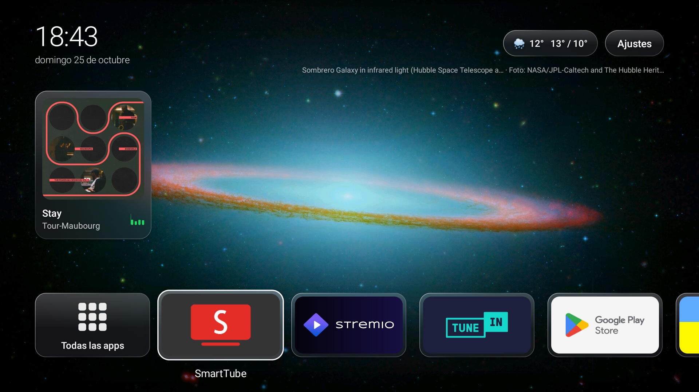

# Vidrio Launcher



Launcher liviano para Android TV (Android 7 o más nuevo), con estilo de vidrio esmerilado al modo de Apple. El APK pesa unos 60 KB: está escrito en Java, sin bibliotecas y sin Gradle.

- Reloj, fecha y estado de la red arriba; botón de Ajustes. El centro queda libre.
- Abajo, una sola fila de **favoritos**. Empieza con **Todas las apps**, que abre la grilla con todo lo instalado. Cada app nueva se suma sola al final de la fila. Las apps de TV muestran su banner.
- **OK** abre la app. **Mantener OK** (o la tecla Menú) abre el menú de la app: agregar o quitar de favoritos, reordenar, ver la información.
- Configuración se abre encima del launcher, que queda visible detrás.
- **Fondo:** por defecto, fotos de astronomía (galaxias, auroras, Vía Láctea, Luna, sistema solar) de las imágenes destacadas de Wikimedia Commons; también fotos de Salta o un degradado. Cambia cada 20 minutos, con fundido, de las "quality images" de Wikimedia Commons, con su crédito y licencia en pantalla.
- **Fútbol en vivo:** una pastilla en la barra de arriba, con punto rojo que late, minuto, escudos y resultado. Solo aparece mientras se juega algo. Si juega Boca, se ve solo ese; si no, los de equipos argentinos (e Inter Miami), y si no hay, el resto, alternándolos. Con OK se abre el detalle: marcador, goles con su autor y minuto, y expulsiones. Lee el tablero público de ESPN, cada minuto si hay partido y cada 15 minutos si no.
- **Clima de Salta:** temperatura actual, máxima y mínima, de Open-Meteo, cada 30 minutos. Con OK se abre el pronóstico de 7 días.
- **Reproduciendo ahora:** un recuadro con la portada del disco, un ecualizador que se mueve mientras suena, el tema y el artista. La portada de Spotify sale del catálogo público de iTunes; en otras apps se muestra su ícono. Aparece si hay algo sonando o en pausa, y se queda una hora con el último tema. Con OK se abre la app.

**Ajustes** abre la configuración del launcher: tema del fondo y cada cuánto cambia, crédito de la foto, fútbol y equipo favorito, clima y ciudad, "Reproduciendo ahora" y cuánto queda el último tema, formato de la hora, y si las apps nuevas van a favoritos. La primera fila lleva a la configuración de Android.

Los widgets solo consultan mientras el inicio está a la vista: con una app abierta, no gastan nada.

## Compilar

Hacen falta el SDK de Android (build-tools 34 y la plataforma android-34) y un JDK 17.

```sh
./build.sh                                  # genera vidrio.apk
VERSION_CODE=2 VERSION_NAME=1.1 ./build.sh  # para una versión nueva
```

La primera vez, `build.sh` crea la clave de firma y su contraseña en `firma/`, que queda fuera de git. **Respaldá esa carpeta**: sin la clave, una versión nueva no se instala encima de la anterior.

## Instalar y dejarlo como pantalla de inicio

```sh
adb install -r vidrio.apk
adb shell cmd package set-home-activity com.augusto.vidrio/.MainActivity
# Para "Reproduciendo ahora": en equipos con poca memoria (ro.config.low_ram) Android no
# deja leer la música de otras apps; este permiso de diagnóstico lo reemplaza.
adb shell pm grant com.augusto.vidrio android.permission.DUMP
```

## Fuentes de datos

Vidrio no tiene servidor propio: cada dato se pide directo a su fuente, sin claves.

- **Clima:** [Open-Meteo](https://open-meteo.com/), con datos bajo licencia [CC BY 4.0](https://creativecommons.org/licenses/by/4.0/).
- **Fondos:** [Wikimedia Commons](https://commons.wikimedia.org/). Cada foto lleva en pantalla su autor y su licencia.
- **Fútbol:** el tablero público de ESPN. No es una API oficial: si ESPN la cambia, la pastilla del partido deja de aparecer y el resto sigue igual.
- **Portadas de discos:** el buscador público de iTunes.

## Licencia

MIT. Ver [LICENSE](LICENSE).
